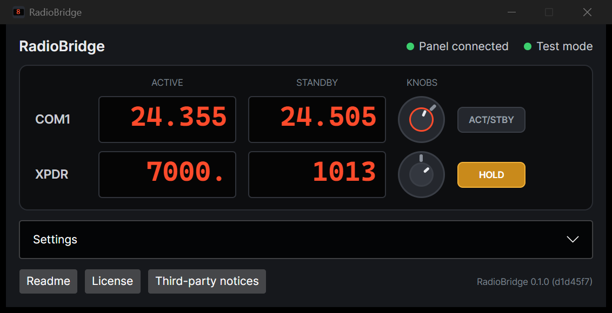
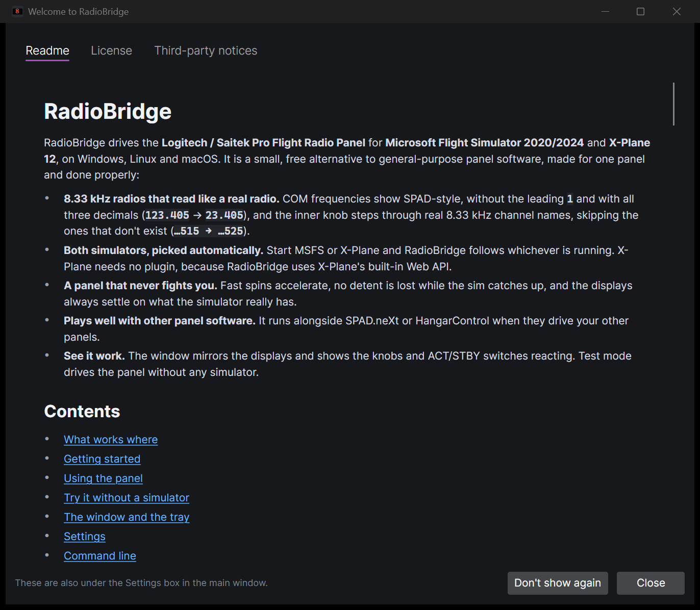

# RadioBridge

RadioBridge drives the **Logitech / Saitek Pro Flight Radio Panel** for **Microsoft Flight Simulator
2020/2024** and **X-Plane 12**, on Windows, Linux and macOS. It is a small, free alternative to
general-purpose panel software, made for one panel and done properly:

- **8.33 kHz radios that read like a real radio.** COM frequencies show SPAD-style, without the
  leading `1` and with all three decimals (`123.405` → `23.405`), and the inner knob steps through
  real 8.33 kHz channel names, skipping the ones that don't exist (`…515 → …525`).
- **Both simulators, picked automatically.** Start MSFS or X-Plane and RadioBridge follows whichever
  is running. X-Plane needs no plugin, because RadioBridge uses X-Plane's built-in Web API.
- **A panel that never fights you.** Fast spins accelerate, no detent is lost while the sim catches
  up, and the displays always settle on what the simulator really has.
- **Plays well with other panel software.** It runs alongside SPAD.neXt or HangarControl when they
  drive your other panels.
- **See it work.** The window mirrors the displays and shows the knobs and ACT/STBY switches reacting.
  Test mode drives the panel without any simulator.



## Contents

- [What works where](#what-works-where)
- [Getting started](#getting-started)
- [Using the panel](#using-the-panel)
- [Try it without a simulator](#try-it-without-a-simulator)
- [The window and the tray](#the-window-and-the-tray)
- [Settings](#settings)
- [Command line](#command-line)
- [Troubleshooting](#troubleshooting)
- [Development](#development)
- [License](#license)

## What works where

|                  | Windows | Linux | macOS |
|------------------|:-------:|:-----:|:-----:|
| X-Plane 12.1.4+  | ✅      | ✅    | ✅    |
| MSFS 2020 / 2024 | ✅      | –     | –     |

MSFS only runs on Windows, and SimConnect is a Windows library. X-Plane works anywhere it runs,
because RadioBridge talks to it over a local WebSocket.

## Getting started

### 1. Get RadioBridge

**Windows:** download `RadioBridge-<version>-win-x64.zip` from the
[latest release](https://github.com/Tolya1/RadioBridge/releases/latest), unzip it anywhere and run
`RadioBridge.exe`. It is a single file with everything inside, so there is nothing to install. The
executable isn't code-signed yet, so Windows SmartScreen asks once: choose **More info › Run anyway**.
The first start takes a moment longer while it unpacks its graphics libraries.

**Linux and macOS:** there are no downloads yet; build the single file yourself (below).

**From source** with the [.NET 10 SDK](https://dotnet.microsoft.com/download) (or let
[mise](https://mise.jdx.dev) install it):

```bash
git clone https://github.com/Tolya1/RadioBridge.git
cd RadioBridge
mise run run
```

Without mise, run `dotnet run --project src/RadioBridge.Desktop`. `mise run package` builds the
single-file executables for Windows, Linux and macOS into `./dist` (see
[docs/packaging.md](docs/packaging.md)).

### 2. Other panel software

RadioBridge opens the panel in shared mode, so other panel software can keep running. That
includes **SPAD.neXt** and **HangarControl** driving your other panels (Multi Panel, Switch Panel,
Stream Decks, …). The only rule: **don't assign the radio panel in their profiles**. Otherwise both
programs react to its knobs.

Software that drives the radio panel on its own has to be disabled for it:

- **Logitech's Flight Panels plugins**
- **xsaitekpanels**

If something still writes to the radio panel's displays (for example a profile switch blanking
every panel), RadioBridge puts its own values back within two seconds.

### 3. Connect your simulator

**X-Plane 12** (12.1.4 or newer). Nothing to install. The Web API is on by default on port 8086.
If RadioBridge doesn't connect, open X-Plane's **Settings › Network** and make sure **Disable
incoming traffic** is off. If you changed X-Plane's port (`--web_server_port`), set the same port
in RadioBridge's settings.

**MSFS 2020 / 2024** (Windows). MSFS is reached through Microsoft's SimConnect library. Microsoft
hasn't said whether that file may be redistributed, so RadioBridge doesn't ship one. It uses the
copy that comes **with MSFS itself** (`SimConnect_internal.dll` in the MSFS 2024 folder,
`SimConnect.dll` in MSFS 2020's), so normally there is nothing to install or configure. It looks in
these places, in order, and uses the first 64-bit library it can load:

1. The file or folder chosen in **Settings › Simulators › SimConnect library** (or with the
   *Locate SimConnect.dll…* button).
2. The `SIMCONNECT_DLL` environment variable (a file or a folder).
3. Next to `RadioBridge.exe`.
4. The folder of the running MSFS, then the Steam installs of MSFS 2024 and MSFS 2020.
5. The MSFS SDKs: `%MSFS2024_SDK%` and `%MSFS_SDK%`, then `C:\MSFS 2024 SDK` and `C:\MSFS SDK`,
   each under `SimConnect SDK\lib\`.

If MSFS is running and none of these works (for example a Microsoft Store install, whose folder
can't be read), the window says so and offers **Locate SimConnect.dll…**: point it at any 64-bit
`SimConnect.dll`, such as the one in the MSFS SDK. The log names the library in use, or lists every
place it searched.

### 4. Linux and macOS

**Linux:** allow your user to open the panel, then replug it:

```bash
sudo cp packaging/linux/99-radiobridge.rules /etc/udev/rules.d/
```

```bash
sudo udevadm control --reload-rules && sudo udevadm trigger
```

Building on Linux with the .NET SDK needs the ICU library (`libicu`, preinstalled on most desktop
distributions). The app itself doesn't, so where ICU is missing, build with
`DOTNET_SYSTEM_GLOBALIZATION_INVARIANT=1` set.

**macOS:** builds are not signed. After building, sign the file ad hoc (Apple Silicon only runs signed
code) and clear the quarantine flag once if it was downloaded, e.g.
`codesign --sign - dist/osx-arm64/RadioBridge` and `xattr -dr com.apple.quarantine dist/osx-arm64`.

## Using the panel

Each row of the panel works on its own. Turn its selector to choose what that row shows.

| Selector | Left display | Right display | Outer knob | Inner knob | ACT/STBY press | ACT/STBY hold |
|---|---|---|---|---|---|---|
| **COM1 / COM2** | active | standby | standby ±1 MHz | standby ±1 channel (8.33 or 25 kHz) | swap | toggle 8.33 / 25 kHz steps |
| **NAV1 / NAV2** | active | standby | standby ±1 MHz | standby ±50 kHz | swap | – |
| **ADF** | ADF1 (upper row) or ADF2 (lower row) | – | ±10 kHz | ±1 kHz | – | – |
| **DME** | DME1 distance | DME2 distance | – | – | – | – |
| **XPDR** | squawk | altimeter | first two squawk digits | last two squawk digits | edit the altimeter instead (outer ±10, inner ±1) and back | VFR squawk, or standard pressure when the altimeter is selected |

Some details:

- **Inner knobs wrap inside the MHz** and **outer knobs wrap at the band edge** (COM 118–136 MHz, NAV
  108–117 MHz), like real radio knobs.
- In XPDR mode, a **lit decimal point at the end** of a display marks the value the knobs edit, e.g.
  `7000.` (squawk) or `1013.` (altimeter). **Holding ACT/STBY acts on that value:** it sets the VFR
  squawk (7000 or 1200, see the settings) or the altimeter's standard pressure.
- **Fast spins accelerate on COM1 and COM2 only**, gently: detents less than 40 ms apart count ×2,
  and less than 20 ms ×3, so a normal turn always moves one channel per detent. NAV, ADF, squawk and
  altimeter always move exactly one step per detent. The limits can be changed in the settings.
- When you change a frequency, the panel shows your new value right away and keeps it for under a
  second while the simulator catches up. After that the simulator's value always wins. So if a radio
  can't tune 8.33 kHz and snaps back, the panel shows that. **Hold ACT/STBY** to switch the inner knob
  to 25 kHz steps for that aircraft.
- When RadioBridge starts, it reads where the selectors are, so the displays fill in right away. On
  macOS this may need one turn of a selector.

## Try it without a simulator

**Test mode** gives RadioBridge built-in radios. While no simulator is connected, the panel works as
if one were: frequencies tune, ACT/STBY swaps, squawk and altimeter change, and the two DME
distances slowly count (DME1 down, DME2 up) so you can see live updates. As soon as MSFS or X-Plane connects, the panel switches to it, and
it goes back to test mode when the simulator quits.

Turn test mode on in **Settings › Test mode**, from the tray menu, or for one run with
`--test-mode`. The window shows **Test mode** where the simulator name usually is.

To check the panel hardware itself, run `RadioBridge --panel-test` (with RadioBridge itself not
running). It finds the panel and reports the selector positions. Then it shows a sequence of test
patterns on the displays (each display's number, every decimal point, dashes, radio-style values)
and prints every knob, selector and button event for 20 seconds.

## The window and the tray

- **The panel row by row:** the selector position, both displays exactly as the panel shows them,
  and the knobs and ACT/STBY switch. Each knob pointer turns one step per detent and its ring lights
  while you turn it. ACT/STBY lights green while pressed and turns amber **HOLD** once a long press
  has fired. This works with or without a simulator, so it also shows whether the panel itself reacts.
- **Status** at the top: whether the panel is connected, and which simulator (or test mode) is driving it.
  When a simulator can't connect for a reason you can fix (MSFS is running but no SimConnect library
  was found, X-Plane refuses connections or is too old), a banner under the status says so.
- **Settings**, folded away below.
- **Readme**, **License** and **Third-party notices** buttons under the settings, and the version
  (with the commit it was built from) for bug reports. They open the documents that are built into
  the executable, so everything is in the one file.

The first time RadioBridge starts, and on every start after that until you choose **Don't show again**,
a window shows the readme, the license and the third-party notices. **Close** closes it for now. You
can turn it back on in **Settings › Window**.



Closing the window quits RadioBridge. To keep it running in the background, turn on **Settings ›
Window › Keep running in the tray**. Then closing the window hides it to the tray: click the tray
icon to bring it back, and use its menu for **Test mode** and **Quit**. Windows 11 puts new tray icons
in the hidden-icons overflow (`^`), so drag the icon onto the taskbar to keep it in sight.

Launching RadioBridge while it is already running brings the running window to the front, even when
it is hidden in the tray.

## Settings

Settings are in the window and are saved immediately to `settings.json` in the data folder:

| OS | Data folder (settings and logs) |
|---|---|
| Windows | `%APPDATA%\RadioBridge` |
| Linux / macOS | `~/.config/RadioBridge` |

| Setting | Default | Meaning |
|---|---|---|
| `ComSpacing` | `Khz833` | Inner COM knob steps: `Khz833` or `Khz25` (hold ACT/STBY on COM to toggle) |
| `CompactComDisplay` | `true` | `23.405` style; `false` shows `123.40` |
| `BaroUnit` | `Hectopascal` | Altimeter in `Hectopascal` or `InchesOfMercury` |
| `VfrSquawk` | `7000` | Squawk set by holding ACT/STBY on XPDR: `7000` (Europe) or `1200` (US) |
| `ComAcceleration` | on, 20 ms ×3, 40 ms ×2 | COM1/COM2 knob acceleration thresholds and multipliers (nothing else accelerates) |
| `LongPressMs` | `600` | How long ACT/STBY must be held for a long press |
| `TestMode` | `false` | Built-in test radios while no simulator is connected |
| `ShowReaderAtStart` | `true` | Open the readme and notices window when RadioBridge starts ("Don't show again" clears it) |
| `CloseToTray` | `false` | Closing the window keeps RadioBridge running in the tray |
| `StartInTray` | `false` | Start hidden in the tray (minimized if `CloseToTray` is off) |
| `MsfsEnabled`, `XPlaneEnabled` | `true` | Which simulators to look for (applied on restart) |
| `SimConnectPath` | none | A SimConnect library for MSFS (a file or a folder), when the automatic search isn't enough |
| `XPlanePort` | `8086` | X-Plane Web API port (applied on reconnect) |

## Command line

```text
RadioBridge [options]
  --headless           Run without a window (stop with Ctrl+C), e.g. on a sim PC without a desktop session.
  --minimized          Start hidden in the tray (or minimized when the tray option is off).
  --test-mode          Drive the panel with built-in test radios while no simulator is connected.
  --panel-test         Check the panel: show test patterns, then print knob and button events.
  --no-panel           Do not open the USB panel.
  --automation PORT    Enable the local automation API (testing only, see docs/testing.md).
  --data-dir DIR       Use another folder for settings.json and logs.
  --readme             Print the readme that is built into this executable.
  --licenses           Print the license and the third-party notices built into this executable.
```

On Windows, the console modes (`--headless`, `--panel-test`, `--readme`, `--licenses`, `--help`) print
to the terminal they were started from. `--readme` and `--licenses` are for where there is no window
(Linux without a desktop, a sim PC you only reach over SSH): they print the same texts as the buttons.

Only **one RadioBridge** runs at a time, in any mode. Launching it again brings the running window to
the front, and a second `--headless` or `--panel-test` refuses to start. The one exception is a test
run with both `--automation` and `--no-panel`, which never touches the panel (see
[docs/testing.md](docs/testing.md)).

## Troubleshooting

| Symptom | What to check |
|---|---|
| *Panel not found* | Is the panel plugged in directly (not through an unpowered hub)? On Linux, install the udev rule. On Windows, the panel shows as a HID device `VID_06A3&PID_0D05`. `--panel-test` checks the hardware on its own. |
| The window's knobs react but the sim doesn't change | The status shows whether a simulator (or test mode) is connected. Check the selector position: DME is read-only. |
| Displays flicker or the knobs do two things | Another program drives the radio panel too. See [Other panel software](#2-other-panel-software). |
| Displays stay blank | No simulator is connected (turn on test mode to try the panel), or on macOS move a selector once. |
| The window is gone but RadioBridge still runs | The tray option is on and the window was closed. Launch RadioBridge again to bring it back, or use the tray icon (look in the hidden icons, `^`). |
| Building fails with "file is locked by RadioBridge" | A running RadioBridge locks its own build output. Quit it first (see the row above if its window is hidden). |
| *No simulator* with X-Plane running | X-Plane 12.1.4+? **Disable incoming traffic** off? Same port? The log says exactly why it can't connect. |
| *No simulator* with MSFS running | The window shows a banner when it can't find a usable SimConnect library: use **Locate SimConnect.dll…** (it must be the 64-bit one). The log names the library it uses, or lists every place it searched. |
| COM steps snap back to the previous value | That aircraft's radio only supports 25 kHz. Hold ACT/STBY on COM to switch to 25 kHz steps. |
| Add-on aircraft ignores the panel | Some airliners (custom radio management panels) don't use the simulator's standard radios, so no external tool can tune them this way. |

Logs are in the `logs` folder in the data folder (one file per day, the last 7 kept). Please attach
the latest one to bug reports.

## Development

```text
src/RadioBridge.Core        panel protocol, radio logic, simulator backends, test mode, automation API
src/RadioBridge.Desktop     Avalonia window and tray, headless mode, panel test, command line
tests/RadioBridge.Tests             unit tests, and the X-Plane backend against the emulator
tests/RadioBridge.FakeXPlane        X-Plane Web API emulator (library and stand-alone tool)
tests/RadioBridge.FunctionalTests   the real app, driven end to end through its automation API
```

All checks run locally with [mise](https://mise.jdx.dev). There is no hosted CI yet.

| Task | What it does |
|---|---|
| `mise run ci` | Everything below except the live-sim tasks: lint, build, unit tests, functional tests |
| `mise run lint` / `mise run format` | Check / fix formatting and code style (`dotnet format`) |
| `mise run test` | Unit tests |
| `mise run functional` | The real app against the X-Plane emulator, driven through the automation API |
| `mise run functional:xplane` | The same scenarios against a running X-Plane 12 with a flight loaded |
| `mise run functional:msfs` | The same scenarios against a running MSFS with a flight loaded |
| `mise run test:hardware` | On a connected panel: shared access both ways, startup state (blanks the displays briefly) |
| `mise run emulator` | X-Plane emulator on port 8086, to try the app without X-Plane |
| `mise run package` | Single-file executables for win-x64, linux-x64, osx-arm64 and osx-x64 in `./dist` |
| `mise run package:windows` | The Windows release zip, built from a clean checkout |
| `mise run functional:package` | Package for this machine, then run the functional tests against that single file |

More in [docs/architecture.md](docs/architecture.md), [docs/testing.md](docs/testing.md),
[docs/packaging.md](docs/packaging.md) and [docs/radio-panel-protocol.md](docs/radio-panel-protocol.md).

## License

[Apache License 2.0](LICENSE). The third-party components, with the full text of each license, are in
[THIRD-PARTY-NOTICES.md](THIRD-PARTY-NOTICES.md). Both are built into the executable too: the
**License** and **Third-party notices** buttons show them, and `RadioBridge --licenses` prints them, so
the single file needs no files next to it.

The panel protocol notes build on the public documentation in
[bjanders/fpanels](https://github.com/bjanders/fpanels). Logitech, Saitek, Microsoft Flight Simulator,
SimConnect and X-Plane are trademarks of their respective owners. RadioBridge is not affiliated with
any of them.
