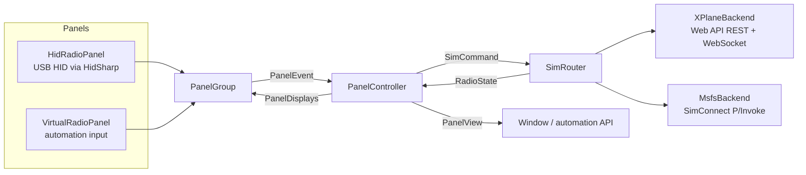

# Architecture

RadioBridge is a .NET 10 app in two projects:

- **RadioBridge.Core**: everything that matters, with no UI dependency.
- **RadioBridge.Desktop**: a thin Avalonia window, a headless mode and the command line.



`BridgeHost` wires these together from `BridgeOptions` (data folder, physical panel on/off,
automation port). The window and `--headless` share it.

## Panel

| Type | Role |
|---|---|
| `RadioPanelProtocol` | Pure encoding and decoding of the USB reports. See [radio-panel-protocol.md](radio-panel-protocol.md). |
| `RadioPanelDecoder` | Turns successive 3-byte input reports into `SelectorMoved`, `KnobTurned` (one per detent) and `ButtonChanged` events. |
| `HidRadioPanel` | Opens the device (VID 06A3, PID 0D05), reads on a background thread, reconnects after unplugging, and only re-sends the display report when it changed. |
| `VirtualRadioPanel` | The same decoder fed with injected reports. It keeps the display report a real panel would get. Used by the automation API. |
| `PanelGroup` | Fans input in and displays out across several panels. |

## Controller

`PanelController` is the only place that decides what the panel does:

- It maps knob and button events to `SimCommand`s, using the selector position of the event's row.
  `Frequencies` handles 8.33 kHz channels, wrapping and band edges, `Squawk` handles octal digit
  pairs, and `KnobAccelerator` turns detent timing into a step multiplier.
- It renders both rows into `PanelDisplays` (`DisplayFormat`) and publishes a `PanelView` for the UI.
- It refreshes every 100 ms and whenever input, sim data or settings change. Unchanged output is
  cheap, because the HID layer drops repeats.

### Hold-off: why the displays never jump back

A simulator reports values back with some delay (X-Plane pushes about ten times a second). If the
controller tuned from the last reported value, a fast spin would keep restarting from stale values
and lose detents. So every value the panel sets is kept as **pending** for 800 ms. It is shown on the
display and used as the starting point for the next detent.

A pending value ends as soon as the simulator reports the same value, or when the 800 ms run out.
From then on, the simulator's own value is shown again. That's how a radio that refuses a frequency
(e.g. 8.33 kHz on a 25 kHz radio) ends up shown truthfully.

## Simulators

Every simulator implements `ISimBackend`:

```csharp
string Name; bool IsConnected; RadioState State; event Action Changed;
void Start(); void Send(SimCommand command);
```

`RadioState` is immutable and uses sim-neutral units:

- COM and NAV in whole kHz, with COM as 8.33 kHz channel names (118.005 MHz = `118005`)
- ADF in kHz
- DME in nautical miles (NaN when there is no station)
- squawk as four octal digits
- altimeter in hPa

Each backend converts to and from its simulator's units. `SimRouter` runs all enabled backends and
exposes the first one that connects. It fails over when that one disconnects.

### X-Plane (`XPlaneBackend`)

This backend uses X-Plane 12's built-in [Web API](https://developer.x-plane.com/article/x-plane-web-api/)
(v2, X-Plane 12.1.4+), so no plugin is needed.

1. It probes `127.0.0.1`, then `::1`. Going through `localhost` costs about 2 s per connection on
   Windows when the server only listens on IPv4.
2. It checks `/api/capabilities` for API v2.
3. Dataref and command ids only live for one X-Plane session, so it looks them up by name over REST
   on every connection.
4. It opens `ws://…/api/v2` and subscribes. X-Plane sends all values first, then only the changes.
5. Writes are `dataref_set_values` messages. Swaps are `command_set_is_active` with `duration: 0`.

| Value | Dataref / command | Unit |
|---|---|---|
| COM1/2 active, standby | `sim/cockpit2/radios/actuators/com{n}[_standby]_frequency_hz_833` | kHz (8.33 channel names) |
| NAV1/2 active, standby | `sim/cockpit2/radios/actuators/nav{n}[_standby]_frequency_hz` | 10 kHz |
| ADF1/2 | `sim/cockpit2/radios/actuators/adf{n}_frequency_hz` | kHz |
| DME1/2 | `sim/cockpit2/radios/indicators/nav{n}_dme_distance_nm` | NM |
| Squawk | `sim/cockpit2/radios/actuators/transponder_code` | octal digits |
| Altimeter | `sim/cockpit2/gauges/actuators/barometer_setting_in_hg_pilot` | inHg |
| Swap | `sim/radios/{com,nav}{n}_standy_flip` (Laminar's spelling) | command |
| Standard pressure | `sim/instruments/barometer_2992` | command |

### MSFS (`MsfsBackend`, Windows only)

This backend calls the native SimConnect C API directly through `LibraryImport`. The SDK's managed
wrapper is a .NET Framework mixed-mode assembly that modern .NET cannot load. `SimConnectLocator`
finds `SimConnect.dll` at run time, because Microsoft's DLL is not redistributed.

One thread owns the connection. It polls `SimConnect_GetNextDispatch` and drains a queue of
outgoing events, so no two SimConnect calls ever overlap. Values are requested every sim frame with
the *changed only* flag.

| Value | Read (SimVar, unit) | Write (event, parameter) |
|---|---|---|
| COM1/2 | `COM ACTIVE/STANDBY FREQUENCY:n`, MHz | `COM_STBY_RADIO_SET_HZ`, `COM2_STBY_RADIO_SET_HZ` (Hz) |
| NAV1/2 | `NAV ACTIVE/STANDBY FREQUENCY:n`, MHz | `NAV1_STBY_SET_HZ`, `NAV2_STBY_SET_HZ` (Hz) |
| Swap | | `COM1_RADIO_SWAP`, `COM2_RADIO_SWAP`, `NAV1_RADIO_SWAP`, `NAV2_RADIO_SWAP` |
| ADF1/2 | `ADF ACTIVE FREQUENCY:n`, kHz | `ADF_COMPLETE_SET`, `ADF2_COMPLETE_SET` (BCD-encoded Hz) |
| DME1/2 | `NAV DME:n` and `NAV HAS DME:n` | |
| Squawk | `TRANSPONDER CODE:1`, BCO16 | `XPNDR_SET` (BCO16) |
| Altimeter | `KOHLSMAN SETTING MB:1`, millibars | `KOHLSMAN_SET` (millibars × 16), `BAROMETRIC_STD_PRESSURE` |

COM values are normalized to channel names whether MSFS reports the channel name (118.010) or the
real 8.33 kHz frequency behind it (118.00833).

## Threads

| Thread | Does |
|---|---|
| HID reader | Reads input reports and raises panel events |
| X-Plane loop (task) | Connects, receives pushes, sends queued messages |
| SimConnect thread | Owns the SimConnect handle |
| Timer | 100 ms display refresh, long-press timers |
| UI thread | Avalonia; gets `PanelView` updates through `Dispatcher.UIThread.Post` |

`PanelController` serializes all its work under one lock. Backends hand out immutable `RadioState`
snapshots, and commands only ever go into queues, so no lock is held across simulator I/O.

## Adding a simulator

Implement `ISimBackend`: connect and reconnect on your own thread or task, publish an immutable
`RadioState`, queue `SimCommand`s, and raise `Changed`. Then add it in `BridgeHost`. The router, the
controller, the UI and the functional tests don't need to change.
