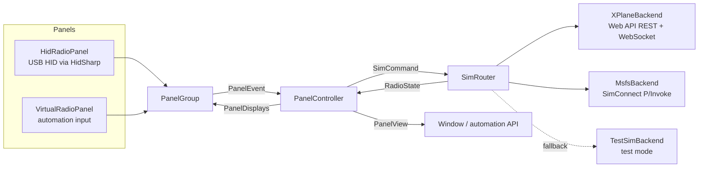

# Architecture

RadioBridge is a .NET 10 app in two projects:

- **RadioBridge.Core**: everything that matters, with no UI dependency.
- **RadioBridge.Desktop**: a thin Avalonia window, a headless mode and the command line.



`BridgeHost` wires these together from `BridgeOptions` (data folder, physical panel on/off,
automation port, forced test mode, recording at start). The window and `--headless` share it, and
it hands the one `Recorder` (see [Debug recording](#debug-recording)) to every part.

The desktop project adds the Avalonia window (`KnobView` and `XferView` draw the controls), the tray
icon, the command line and `--panel-test`.

## Panel

| Type | Role |
|---|---|
| `RadioPanelProtocol` | Pure encoding and decoding of the USB reports. See [radio-panel-protocol.md](radio-panel-protocol.md). |
| `RadioPanelDecoder` | Turns successive 3-byte input reports into `SelectorMoved`, `KnobTurned` (one per detent) and `ButtonChanged` events. |
| `HidRadioPanel` | Opens the device (VID 06A3, PID 0D05), reads on a background thread, and reconnects after unplugging. It sends the display report when it changes, and again every 2 s in case another program wrote to the panel. |
| `CurrentInputReport` | Reads the panel's current state right after opening, because the panel only reports changes. It uses HID GET_REPORT: `HidD_GetInputReport` on Windows, `HIDIOCGINPUT` on Linux, and a feature-report fallback elsewhere (the firmware answers every report request with its input state). |
| `VirtualRadioPanel` | The same decoder fed with injected reports. It keeps the display report a real panel would get. Used by the automation API. |
| `PanelGroup` | Fans input in and displays out across several panels. |

### Sharing the panel with other software

RadioBridge never locks other programs out of the panel. HidSharp's opt-in exclusivity layer is
explicitly off (`HidRadioPanel.SharedAccess`), and the OS handle is shared for reading and writing.
So SPAD.neXt, HangarControl or a second tool can always open the device. The worst case, when two
programs drive the same panel, is a fight over the displays, never a lock-out.
`mise run test:hardware` checks both directions on a real panel.

## Controller

`PanelController` is the only place that decides what the panel does:

- It maps knob and button events to `SimCommand`s, using the selector position of the event's row.
  `Frequencies` handles 8.33 kHz channels, wrapping and band edges, `Squawk` handles octal digit
  pairs, and `KnobAccelerator` turns detent timing into a step multiplier.
- It renders both rows into `PanelDisplays` (`DisplayFormat`) and publishes a `PanelView` for the UI.
  The view also carries each row's `RowActivity`: net knob detents, and whether ACT/STBY is held or
  a long press has fired. The window draws the knobs and switches from it, with or without a sim.
- It refreshes every 100 ms and whenever input, sim data or settings change. Unchanged output is
  cheap, because the HID layer drops repeats.

### Hold-off: why the displays never jump back

A simulator reports values back with some delay (X-Plane pushes about ten times a second). If the
controller tuned from the last reported value, a fast spin would keep restarting from stale values
and lose detents. So every value the panel sets is kept as **pending** for 800 ms. It is shown on the
display and used as the starting point for the next detent.

A pending value ends as soon as the simulator reports the same value, or when the 800 ms run out.
From then on, the simulator's own value is shown again. That's how a radio that refuses a frequency
(e.g. 8.33 kHz on a 25 kHz radio) ends up shown truthfully.

A swap works the same way: ACT/STBY shows the swapped pair at once and holds it until the simulator
reports it (or 800 ms pass). Some radios take a moment and swap in steps: REP's KX165 swaps when the
press ends and writes the standby a frame before the active, so without the hold the display would
show the old pair, then the same frequency twice, then the new pair.

### GPS control

With `GpsControl` on, a row whose selector is on ADF or DME drives a GNS 430/530 instead of the radios,
as long as the connected simulator takes GPS keys (`ISimBackend.SupportsGpsKeys`, so far only X-Plane;
otherwise ADF and DME stay radios). The upper row drives GPS 1, the lower row `LowerRowGps` (2, or 1 for
aircraft with one GNS). The controller turns input into `PressGpsKey(unit, GpsKey)` commands:

- **ADF** is the GNS's right-hand corner: outer knob = large knob, inner knob = small knob, a press = ENT,
  a hold = CRSR. Displays: distance and desired track to the active waypoint, `----` without one.
- **DME** has the other keys. The inner knob moves a per-row choice through a fixed list, counted in clicks
  from D→ (`-1` CLR held, `0` D→, then MENU, FPL, PROC, CDI, OBS, MSG, VNAV), shown as that number on the
  left display (the panel has no letters; the view's `GpsRow` gives the window the name). A press sends the
  chosen key and puts the choice back on D→, a hold is CLR, the outer knob is the map range. Moving the
  selector also resets the choice.

GPS keys aren't pending values: nothing is laid over the display, which shows only what the GPS reports.

## Simulators

Every simulator implements `ISimBackend`:

```csharp
string Name; bool IsConnected; RadioState State; event Action Changed;
void Start(); void Send(SimCommand command);
bool SupportsGpsKeys; // default false: takes PressGpsKey
```

`RadioState` is immutable and uses sim-neutral units:

- COM and NAV in whole kHz, with COM as 8.33 kHz channel names (118.005 MHz = `118005`)
- ADF in kHz
- DME in nautical miles (NaN when there is no station)
- squawk as four octal digits
- altimeter in hPa
- each GPS's distance (NM) and desired track (degrees) to its active waypoint, and whether it has one

Each backend converts to and from its simulator's units. `SimRouter` runs all enabled backends and
exposes the first one that connects. It fails over when that one disconnects.

`TestSimBackend` is the router's *fallback*: built-in radios that are connected while test mode is
on. The router only picks it when no real simulator is connected, and switches away as soon as one
connects. It applies commands instantly and moves both DMEs (DME1 down, DME2 up) once a second, so live updates show.

### X-Plane (`XPlaneBackend`)

This backend uses X-Plane 12's built-in [Web API](https://developer.x-plane.com/article/x-plane-web-api/)
(v2, X-Plane 12.1.4+), so no plugin is needed.

1. It probes `127.0.0.1`, then `::1`. Going through `localhost` costs about 2 s per connection on
   Windows when the server only listens on IPv4.
2. It checks `/api/capabilities` for API v2.
3. Dataref and command ids only live for one X-Plane session, so it looks them up by name over REST
   on every connection.
4. It opens `ws://…/api/v2` and subscribes. X-Plane sends all values first, then only the changes.
5. Writes are `dataref_set_values` messages. Swaps are `command_set_is_active` with `duration: 0.15`:
   a held press that X-Plane releases after 150 ms, like a click on the cockpit button. Add-on radios
   may act only on the release of a command that was held for at least a frame, and ignore a press
   that begins and ends in the same frame (`duration: 0`). REP's Bendix King KX165 in the SF-260 does
   this (measured live: 20 ms presses never swapped, 50 ms did); stock radios and GTNs swap on the press.

| Value | Dataref / command | Unit |
|---|---|---|
| COM1/2 active, standby | `sim/cockpit2/radios/actuators/com{n}[_standby]_frequency_hz_833` | kHz (8.33 channel names) |
| NAV1/2 active, standby | `sim/cockpit2/radios/actuators/nav{n}[_standby]_frequency_hz` | 10 kHz |
| ADF1/2 | `sim/cockpit2/radios/actuators/adf{n}_frequency_hz` | kHz |
| DME1/2 | `sim/cockpit2/radios/indicators/nav{n}_dme_distance_nm` | NM |
| Squawk | `sim/cockpit2/radios/actuators/transponder_code` | octal digits |
| Altimeter, and standard pressure | `sim/cockpit2/gauges/actuators/barometer_setting_in_hg_pilot` | inHg |
| Swap | `sim/radios/{com,nav}{n}_standy_flip` (Laminar's spelling) | command, held 150 ms |
| GPS 1/2 distance, desired track, waypoint | `sim/cockpit2/radios/indicators/gps[2]_dme_distance_nm`, `sim/cockpit/radios/gps[2]_obs_degm`, `sim/cockpit/radios/gps[2]_fromto` (0 = flag: no waypoint) | NM, degrees, enum |
| GNS 430/530 keys and knobs | `sim/GPS/g430n{1,2}_{chapter_up,chapter_dn,page_up,page_dn,cursor,ent,clr,direct,menu,fpl,proc,cdi,obs,msg,vnav,zoom_in,zoom_out}` | commands: knob clicks held 50 ms, keys 150 ms, CLR held 2.5 s |

**GNS keys go out one by one.** A press that starts while the same command is still held need not count
as a click of its own, so a fast knob spin could lose detents. GPS keys therefore have their own queue
per connection: they leave in the order they came, and a command waits until its previous press has
ended plus 50 ms. A knob click is held 50 ms, so the small knob types up to about ten letters a second.
Whether X-Plane's GNS has a long-press CLR is unchecked; "CLR held" holds `clr` for 2.5 s.

**When X-Plane answers late.** X-Plane answers every request with a `result` message, normally within a
frame or two. One user's X-Plane answered about 30 s late, in order (GitHub issue #1): every knob change
sprang back once the controller's 800 ms hold-off ended, and half a minute later X-Plane replayed each
detent, so the values seemed to change by themselves. `XPlaneRequests` keeps the books per connection:

- **Writes are coalesced.** Writes to one dataref less than 100 ms apart are merged, so a fast spin sends
  the newest value every 100 ms instead of one message per detent.
- **What was set stays shown until X-Plane answers.** The backend's `State` lays every write and swap that
  X-Plane hasn't answered (and, for 500 ms after the answer, while the value travels back) over X-Plane's
  values. A swap is laid over as the pair it should produce, so it can't be undone once X-Plane has made it.
  A refused write is dropped at once.
- **The user is told.** When an answer is more than 2 s late (or a request has waited that long), the
  backend's `Notice` says how late, and the window shows it while X-Plane is connected. It goes as soon as
  an answer comes in time. The recording has each answer's delay (`lagMs`) and `slow`/`caught-up` events.

**Altimeter values are the exact setting plus a tiny margin.** X-Plane stores the setting in inHg as a
32-bit float. A knob step in hPa writes that whole hPa exactly (1040 hPa = 30.7112 inHg, which is what
X-Plane's own knob stores), and a step in inHg writes the two-decimal value (29.91). Some cockpits draw
the setting by cutting digits off instead of rounding: the Thranda PC-6's altimeter shows
floor(inHg × 33.864) in hPa and floor(inHg × 100) in inHg. A float can't hold 29.91 exactly (it becomes
29.9099998, shown as 29.90), so every write adds 0.00005 inHg (0.002 hPa, invisible on any altimeter).
Unit tests check that every hPa from 900 to 1100 and every inHg from 26.58 to 32.48 shows as itself under
those formulas. (Rounding hPa settings to two inHg decimals, as 0.1.1 did, made 1013 hPa show as 1012
there.) Standard pressure is a write of 29.92. X-Plane's own `barometer_2992` command is not used: it
leaves the internal 1013.25 hPa (29.92125 inHg).

### MSFS (`MsfsBackend`, Windows only)

This backend calls the native SimConnect C API directly through `LibraryImport`. The SDK's managed
wrapper is a .NET Framework mixed-mode assembly that modern .NET cannot load.

Microsoft's SimConnect library is not redistributed, so `SimConnectLocator` finds one on the machine
at run time. The best place is the sim's own install folder: MSFS 2024 carries the client library as
`SimConnect_internal.dll` and MSFS 2020 as `SimConnect.dll` (both are 64-bit and export everything
RadioBridge calls; this was checked against a live MSFS 2024). The search order is the setting, the
`SIMCONNECT_DLL` variable, RadioBridge's own folder, the running MSFS process's folder, the Steam
installs, and last the SDKs. `ILocatorEnvironment` abstracts the machine so the order is unit tested.

The backend thread starts even when nothing is found and keeps looking, so starting RadioBridge
before MSFS, or choosing a library later, needs no restart. It tries every library the locator
returns until one loads; a native library can't be swapped once loaded, so after that a different
choice applies on restart. A missing library only becomes a **notice** (`SimNotice`) once MSFS is
running, because many users only fly X-Plane. Backends expose `Notice`, `SimRouter` combines them while no
real simulator is connected, and the window shows them as a banner (with a *Locate SimConnect.dll…*
button for this one). X-Plane reports a refusal ("Disable incoming traffic") and a too-old version
the same way.

One thread owns the connection. It polls `SimConnect_GetNextDispatch` and drains a queue of
outgoing events, so no two SimConnect calls ever overlap. Values are requested every sim frame with
the *changed only* flag.

| Value | Read (SimVar, unit) | Write (event, parameter) |
|---|---|---|
| COM1/2 | `COM ACTIVE/STANDBY FREQUENCY:n`, MHz | `COM_STBY_RADIO_SET_HZ`, `COM2_STBY_RADIO_SET_HZ` (Hz) |
| NAV1/2 | `NAV ACTIVE/STANDBY FREQUENCY:n`, MHz | `NAV1_STBY_SET_HZ`, `NAV2_STBY_SET_HZ` (Hz) |
| Swap | | `COM1_RADIO_SWAP`, `COM2_RADIO_SWAP`, `NAV1_RADIO_SWAP`, `NAV2_RADIO_SWAP` |
| ADF1/2 | `ADF ACTIVE FREQUENCY:n`, kHz | `ADF_COMPLETE_SET`, `ADF2_COMPLETE_SET` (BCD-encoded Hz) |
| DME1/2 | `NAV DME:n` and `NAV HAS DME:n` | |
| Squawk | `TRANSPONDER CODE:1`, BCO16 | `XPNDR_SET` (BCO16) |
| Altimeter | `KOHLSMAN SETTING MB:1`, millibars | `KOHLSMAN_SET` (millibars × 16), `BAROMETRIC_STD_PRESSURE` |

COM values are normalized to channel names whether MSFS reports the channel name (118.010) or the
real 8.33 kHz frequency behind it (118.00833).

## The built-in documents

The readme, the license and the third-party notices are embedded resources (the repository's own
`README.md`, `LICENSE` and the generated `THIRD-PARTY-NOTICES.md`, linked into the Desktop project, so
there is one copy of each). `DocumentLibrary` reads them; `Program` prints them for `--readme` and
`--licenses`, and the window shows them in the `ReaderWindow`.

Avalonia has no Markdown view (the available libraries don't support Avalonia 12, or need a commercial
license), so `MarkdownRenderer` turns a Markdig syntax tree into ordinary controls: headings, paragraphs,
bold and italic, inline code, links, lists, quotes, pipe tables and fenced code. Images are left out, since
the window is the picture. Details that matter:

- **Links** are runs inside a text block, which get no pointer events, so a click is mapped back from the
  text layout's hit position to the link whose character range it falls in. A drag that selected text is
  not a click. What a link does is decided in Core (`DocumentLinks`, unit tested): `#heading` scrolls to it,
  a link to `LICENSE` or `THIRD-PARTY-NOTICES.md` switches tab, a web link opens in the browser, any other
  file opens on GitHub, and every other scheme (`file:`, `javascript:`) is ignored.
- **Anchors** follow GitHub's rule for heading names, so the readme's contents list works in the app and on
  GitHub alike, and a unit test checks every link in the readme points at a heading that exists.
- **Long texts** (the notices run to thousands of lines) are laid out in pieces of 60 lines, because one
  giant text block makes the first display slow. A tab is only built when it is first shown.

`StartupReader` decides when the window opens by itself: until "Don't show again" is chosen
(`ShowReaderAtStart`), not when started hidden, never in an automated run.

## Debug recording

`Recorder` (Core, `Diagnostics`) writes a JSON Lines file while a recording runs: one event per line with
`ms`, `t`, `src` and `ev`, plus the event's own fields. Every part records what it alone knows:

| `src` | Events | From |
|---|---|---|
| `panel` | `report` (raw input bytes; `current` for the state read at connection), `displays` (the display report when it changes), `input` (decoded), `connected` | `HidRadioPanel`, `PanelController` |
| `controller` | `tune` (from, to, steps, acceleration), `swap`, `focus`, `hold`, `ignored` (and why), `unconfirmed` (a value the sim didn't take within the hold-off), `displays` (the four texts) | `PanelController` |
| `sim` | `active`, `state` (the radios in RadioBridge's units), `notice` | `SimRouter` |
| `xplane` | `connected` (version, dataref and command ids), `watching`, `values` (by dataref name), `set`, `held` (a write merged into a later one), `command`, `result` (X-Plane's reply to each request, with `lagMs`), `slow` / `caught-up` | `XPlaneBackend` |
| `msfs` | `connected` (the library), `values` (SimVars by name), `event`, `exception`, `quit` | `MsfsBackend` |
| `settings`, `log`, `recorder` | settings changes, every log line (debug and up, via `RecorderLoggerProvider`), start (version, OS, settings) and stop | `BridgeHost`, the logger |

While recording, the X-Plane backend also subscribes to a **watch list** (`XPlaneWatchList`): the rest of
X-Plane's radio, altimeter and avionics-power datarefs, the aircraft's identity, and every add-on dataref
whose name looks radio-related (REP's KX165 knobs and swap buttons, circuit breakers, a GTN's units, a
custom altimeter's unit switch). Continuously changing instrument outputs are left out. When another
aircraft loads, the list is built again. On a live SF-260 it held 314 of X-Plane's 9406 datarefs.

`Record` does nothing while no recording runs. Otherwise it formats the line on the calling thread
and queues it; a background task writes the queue and flushes whenever it runs dry. The file is shared
for reading, and a recording stops by itself at 200 MB. Recordings go next to the executable
(`AppPaths.ExecutableDirectory`, `AppContext.BaseDirectory`, which for the single file is where
`RadioBridge.exe` is), where users find them; if that folder can't be written, `recordings` in the data
folder; with `--data-dir`, `recordings` in that folder. Starting one deletes all but the newest 20
`radiobridge-*.jsonl` files in the folder. The window, the tray, `--record`, the `RecordAtStart` setting
(off by default) and the automation API (`POST /api/recording`) start and stop it.

## Threads

| Thread | Does |
|---|---|
| HID reader | Reads input reports and raises panel events |
| X-Plane loop (task) | Connects, receives pushes, sends queued messages |
| SimConnect thread | Owns the SimConnect handle |
| Timer | 100 ms display refresh, long-press timers |
| Recorder (task) | Writes queued recording events to the file |
| UI thread | Avalonia; gets `PanelView` updates through `Dispatcher.UIThread.Post` |

`PanelController` serializes all its work under one lock. Backends hand out immutable `RadioState`
snapshots, and commands only ever go into queues, so no lock is held across simulator I/O.

## Adding a simulator

Implement `ISimBackend`: connect and reconnect on your own thread or task, publish an immutable
`RadioState`, queue `SimCommand`s, and raise `Changed`. Then add it in `BridgeHost`. The router, the
controller, the UI and the functional tests don't need to change.
